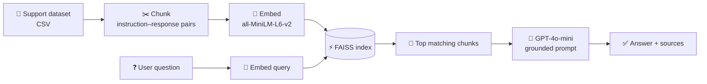

<div align="center">

# 🤖 RAG-Powered Customer Support Chatbot

### Answers grounded in your real support data, not guesses.

A lightweight **Retrieval-Augmented Generation** chatbot that finds the most relevant support articles with semantic search and lets GPT write a concise, cited answer from them.

<br />

[](https://rag-chatbot-nrkd3tb8gx3vjceqtxa2xb.streamlit.app)


[Demo](#-live-demo) · [How It Works](#-how-it-works) · [Quick Start](#-quick-start) · [Deploy](#-deploy-on-streamlit-cloud) · [Dataset](#-dataset) · [Features](#-features)

</div>

---

## 🎯 Use Cases

| | |
|---|---|
| 💬 **Customer support FAQs** | Instant answers from your existing Q&A data |
| 🛠️ **Product troubleshooting** | Step-by-step help pulled from real instructions |
| 🏢 **Internal helpdesk** | A searchable assistant for company knowledge |
| 🧪 **GenAI demos** | A compact, readable reference RAG implementation |

---

## 🚀 Live Demo

👉 **[Launch the app](https://rag-chatbot-nrkd3tb8gx3vjceqtxa2xb.streamlit.app)**

Try asking:

- *"How do I cancel an order?"*
- *"Can I change my delivery address?"*
- *"What's your return policy?"*

---

## 🧠 How It Works



1. **Load and clean** a customer support dataset (CSV)
2. **Chunk** the instruction–response pairs into small text segments
3. **Embed** the chunks with `all-MiniLM-L6-v2` via `sentence-transformers`
4. **Index** the embeddings in FAISS for fast similarity search
5. **Retrieve** the top matching chunks for each user query
6. **Prompt** OpenAI's `gpt-4o-mini` with those chunks as context
7. **Answer** concisely, with the source chunks shown for transparency

---

## ✨ Features

- ✅ Full RAG pipeline powered by FAISS
- ✅ Streamlit chat interface with conversation memory
- ✅ Inline display of the source chunks behind each answer
- ✅ GPT-4o-mini for fast, low-cost responses
- ✅ Lightweight, under 100 MB

---

## 📂 Project Structure

```text
rag-chatbot/
├── app.py                                  # Main Streamlit app
├── Customer_Support_Training_Dataset.csv   # Support Q&A data
├── requirements.txt                        # Python dependencies
└── README.md                               # Project documentation
```

---

## ⚡ Quick Start

### 1. Clone the repository

```bash
git clone https://github.com/your-username/rag-chatbot.git
cd rag-chatbot
```

### 2. Create a virtual environment *(recommended)*

```bash
python -m venv venv
source venv/bin/activate      # Windows: venv\Scripts\activate
```

### 3. Install dependencies

```bash
pip install -r requirements.txt
```

### 4. Add your OpenAI API key

```bash
echo "your-openai-api-key" > OPENAI_API_KEY.txt
```

> ⚠️ **Never commit your API key.** Add `OPENAI_API_KEY.txt` to your `.gitignore`.

### 5. Run the app

```bash
streamlit run app.py
```

Then open **http://localhost:8501**.

---

## ☁️ Deploy on Streamlit Cloud

Keep your key out of the repo by using Streamlit secrets.

**1.** In your app's **Settings → Secrets**, add:

```toml
OPENAI_API_KEY = "your-api-key"
```

**2.** Read it in `app.py`:

```python
import streamlit as st
from openai import OpenAI

client = OpenAI(api_key=st.secrets["OPENAI_API_KEY"])
```

---

## 📚 Dataset

The app uses a cleaned and chunked customer support Q&A dataset in this format:

| instruction | response |
|---|---|
| How to cancel my order? | You can cancel by logging in. |
| Can I change my address? | Yes, go to profile settings. |

Want to use your own data? Swap in any CSV with `instruction` and `response` columns.

---

## 🔧 Requirements

```text
streamlit
pandas
faiss-cpu
sentence-transformers
openai
```

---

<div align="center">

**If you found this useful, consider giving it a ⭐**

</div>
